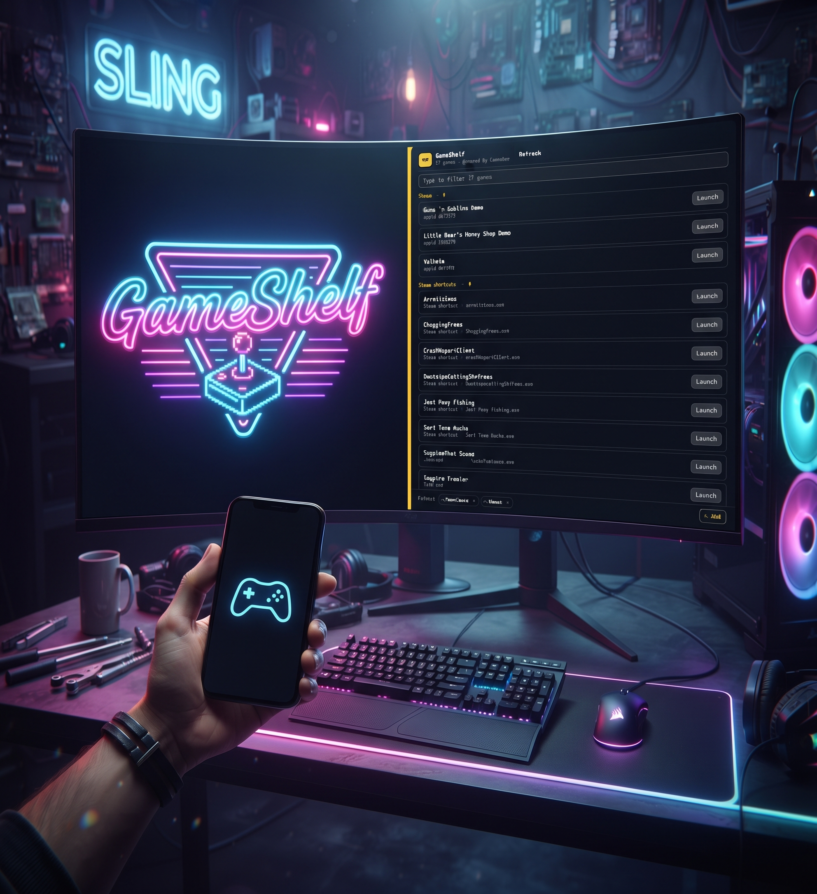

# GameShelf

One bar icon for every game on this machine — Steam (including the non-Steam
games you added to it), Lutris, Heroic, anything with a game entry in your
application menu, and any folder you point it at. Click the controller, type a
few letters, play.

A download that is not a game yet shows up here too: a repack archive gets
**Unpack**, a downloaded installer gets **Install <game>**, and the same row
turns into **Launch** when the game exists. See
[Downloads that are not games yet](#downloads-that-are-not-games-yet).



[OmaGames](https://github.com/davidsmorais/omarchy-omagames) lists Omarchy *game
plugins*. A Steam, Lutris or Heroic library is not a plugin and can never appear
there. GameShelf is the other half: it reads the launchers themselves, plus plain
folders full of repacks, and starts the real games. The two sit happily side by
side — one icon for widget games, one for everything else.

## Install

```bash
omarchy plugin add https://github.com/alexwest1981/GameShelf --enable
```

From a clone instead:

```bash
bash install.sh              # copy into ~/.config/omarchy/plugins, validate, enable
bash install.sh --no-enable  # same, but leave it out of the bar
```

The repository owns the sources; the plugin folder is a build artifact, so run
`install.sh` again after `git pull`. A changed `Panel.qml` needs
`omarchy restart shell`: the shell reloads the bar widget on a file change but
keeps a panel it has already created, which shows up as a panel with the old
buttons and the new data. Nothing needs root.

## Remove

```bash
omarchy plugin remove io.github.alexwest1981.gameshelf --yes
```

`omarchy plugin disable io.github.alexwest1981.gameshelf` only takes the icon out
of the bar and keeps the plugin installed. Settings live on the bar layout entry,
so removing the plugin removes them with it.

## Settings

Folders are picked in the panel: **Folders → + Add** opens a folder picker, and
the × on a chip takes that folder out again. The list is written to the bar
layout entry, so it lives with the widget and survives a reinstall. A folder
that is already listed (with or without a trailing slash) is not added twice.

Sources and hidden games are set on the command line, and `folders` still works
there too — for a script, or for a machine you are setting up over ssh:

```bash
omarchy bar set io.github.alexwest1981.gameshelf sources "steam,heroic,folders"   # drop lutris
omarchy bar set io.github.alexwest1981.gameshelf folders "~/Downloads,~/Games"    # same list as the panel
omarchy bar set io.github.alexwest1981.gameshelf hiddenIds "steam:892970"         # never list this one
```

| Key | Default | What it does |
|---|---|---|
| `sources` | `steam,shortcuts,lutris,heroic,desktop,folders` | Which launchers to scan, comma separated. |
| `folders` | `~/Downloads,~/Games` | Folders searched (three levels down) when `folders` is on. |
| `hiddenIds` | *(empty)* | Ids to hide. Ids are shown in the panel: `steam:892970`, `shortcut:123456`, `heroic:<app_name>`, `desktop:<entry>`, `file:/path/to/game`. |

The panel groups the list by where each game came from, so `sources` is also the
grouping: turn a launcher off and its section disappears.

With every source on the list is longer than the panel, so there is a filter
field under the header: type part of a name, a detail or a source and the
sections narrow to the matches (Escape empties the field, a second Escape closes
the panel).

## What it finds

| Source | Where it reads | How it starts |
|---|---|---|
| **Steam** | `appmanifest_*.acf` in every library listed in `libraryfolders.vdf` — other drives included — minus Proton and the Steam Linux Runtimes, which are not games | `steam://rungameid/<appid>` |
| **Steam shortcuts** | `userdata/<id>/config/shortcuts.vdf`: the non-Steam games you added to Steam by hand | `steam://rungameid/<shortcut appid>`, so Steam's own Proton setup runs them |
| **Lutris** | `~/.config/lutris/games/*.yml` | `lutris:rungame/<slug>` |
| **Heroic** | side-loaded apps, Epic (`legendary`) and GOG libraries under `~/.config/heroic/` | the game's own executable, otherwise `heroic://launch/<runner>/<app_name>` |
| **Desktop** | `.desktop` entries with `Categories=Game` in `~/.local/share/applications`, `/usr/share/applications` and the Flatpak exports. Entries that are a front end for another library (Steam, Lutris, Heroic, Moonlight, Bottles, itch, RetroArch, Prism) are left to the source that owns their games | `gio launch <entry>` |
| **Folders** | one starter per folder: the native starter if there is one, then an AppImage, then a bare `.exe` through Wine; helper scripts and crash handlers are skipped, and a folder whose only starter is an installer becomes an **Install** row | the executable itself — a script that lost its exec bit in the unpack goes through `bash` — and an `.exe` through `bin/game-wine.sh` |
| **Archives** | `.rar`, `.zip` and `.7z` in a folder you scan, when the archive holds a starter, minus archives that already have an unpacked folder beside them | **Unpack** to `~/Games` (the game row appears when it is done) |
| **Installers** | a folder whose only starter is `setup.exe` / `Install.exe` — FitGirl, KaOs, Vanya repacks, a GOG setup | **Install <game>** through Proton, then **Launch** |

A folder whose only playable thing is a Windows `.exe` (a repack with `game/Game.exe`
and nothing else) becomes a normal row, started through Wine in a **prefix of its
own** under `~/.local/share/gameshelf/wine/<folder>-<hash>`. One prefix per game
means a `winetricks` tweak or a 32-bit title in one prefix cannot break the next,
nothing is written into the game folder, and deleting the prefix is the whole
uninstall. Point `GAMESHELF_WINE_DIR` somewhere else to move them.

A bare `.exe` row — a repack you already unpacked by hand — starts through system
Wine. Anything GameShelf itself produced (an unpacked archive, an installed game)
starts through the Proton build Steam has installed, and falls back to system Wine
when there is none. A `winetricks` tweak (`bin/game-wine.sh --setup`) follows the
same split: bare Wine for a bare-Wine prefix, Proton's own wine for a Proton one.
A game with anti-cheat still belongs in Steam — add it there as a non-Steam game,
which is what the `Steam shortcuts` source above is for.

Steam, Lutris and Heroic each register a URI handler on a normal install, so
everything GameShelf does not own is started through `xdg-open`. One code path,
no per-launcher quoting, and no guessed command-line arguments.

The list is built when the panel opens, so a new install shows up without a
restart. Launching happens detached — the game keeps running if the panel closes.

## Downloads that are not games yet

A repack or an installer sitting in a folder you already scan becomes a row with
its own button instead of something you unpack by hand first:

| You downloaded | The row says | Pressing it |
|---|---|---|
| `Some.Game.rar` / `.zip` / `.7z` with a game inside | **Unpack** | unpacks into `~/Games/Some.Game` (`~/Games` is created if missing) |
| `setup.exe` / `Install.exe` — FitGirl, KaOs, Vanya, a GOG setup | **Install Some Game** | runs the installer once, through Proton, in a prefix of its own |

While the work runs the row says `Unpacking…` or `Installing…` and its button is
greyed out. When it finishes the same row grows a working **Launch**, and its own
button becomes **Remove archive** — which asks once whether the download should go
to the trash (recoverable) or be deleted for good. The unpacked game is never
touched by either answer.

- **Where it lands.** Unpacking goes to `~/Games` (`GAMESHELF_GAMES_DIR` moves it),
  which is in the default folder list, so the game keeps showing up after the row
  is removed. An installed game lives inside its prefix under
  `~/.local/share/gameshelf/wine/<name>-<hash>`, and the row carries that path.
- **Proton, not bare Wine.** Installers, and the games they leave behind, run
  through the Proton build Steam already has installed — with no Proton they fall
  back to system Wine. That is what makes DXVK-era repacks and installers work, and
  it costs one prefix per game, created on first use (a minute, once).
- **The work outlives the panel.** `bin/game-setup.sh` does it and writes one state
  file per task under `~/.local/share/gameshelf/tasks`; close the panel mid-unpack
  and it keeps going, open it again and the row is still `Unpacking…`. The panel
  rescans every two seconds while something is running.
- **Which archives count.** One that holds a starter: an `.exe`, an `.AppImage`, a
  Godot `.pck`, an Unreal `.pak`. Measured on this box: 15 of 16 flagged archives
  were games and no texture or sound pack was flagged. Listing an archive is slow
  the first time (a cold 16 GB rar takes ~20 s), so the scan never does it — the
  panel runs `scan-games.py --classify` once in the background and rescans. Answers
  are cached by size and mtime in `~/.local/share/gameshelf/archives.json`.
- **An unpacked twin wins.** If `Some.Game/` already sits beside `Some.Game.rar`,
  the folder row is the game and the archive is not offered again.
- **Hiding one** works like any other id:

  ```bash
  omarchy bar set io.github.alexwest1981.gameshelf hiddenIds "file:/home/you/Downloads/Some.Game.rar"
  ```

## A game that wants .NET

Proton ships Wine-Mono (Experimental 11.0 carries `wine-mono-11.3.0`), and that is
enough for many small .NET apps. A repack installer or a game built against the
real framework wants the real framework, so name the winetricks verbs and they go
into that game's own prefix before the installer runs:

```sh
GAMESHELF_VERBS=dotnet48 ./bin/game-setup.sh install ~/Downloads/Game/Setup.exe
GAMESHELF_VERBS="dotnet48 vcrun2022" ...        # several, space-separated
```

Measured on this machine, because it is not the obvious path: **Proton's own wine
cannot install .NET** (`dotnet48` ends at `dotNetFx40 … status 67` and leaves no
`v4\Full` key at all; the `mscoree=d` override changes nothing). System Wine can —
into a Proton prefix — and Proton then reads it: `Release 528049`
(`Version 4.8.03761`), 1.3 GB of prefix, about 14 minutes including the download,
once. So `--setup` on a Proton prefix runs `winetricks` with system Wine against
`<prefix>/pfx`, and the game still starts under Proton, DXVK included. An existing
prefix takes verbs afterwards with
`bin/game-wine.sh --proton --setup --in <prefix> <game>.exe dotnet48`.

Costs `winetricks` and `cabextract` (both in Dependencies) and a network for the
redistributable, once. A game that wants a *bare* Wine prefix (no Proton at all)
gets one from a plain `.exe` row; nothing here forces Proton.

## Environment

Four variables, all optional — the defaults are what the panel uses:

| Variable | Default | What it moves |
|---|---|---|
| `GAMESHELF_GAMES_DIR` | `~/Games` | where **Unpack** puts a game |
| `GAMESHELF_WINE_DIR` | `~/.local/share/gameshelf/wine` | the per-game Wine/Proton prefixes |
| `GAMESHELF_PROTON` | *(first installed build)* | which Proton to run instead of `~/.local/share/Steam/steamapps/common/Proton*` |
| `GAMESHELF_STATE_DIR` | `~/.local/share/gameshelf/tasks` | the one-file-per-task state the panel reads, and the archive cache beside it |

The bar icon counts what can actually be started, so a download waiting to be
unpacked does not inflate the number next to it.

## Manual scan and tests

The scanner is a standalone script; the widget and the panel both just run it.

```bash
python3 scan-games.py '{"sources":["steam","heroic","folders"],"folders":["~/Downloads"]}' | python3 -m json.tool
python3 scan-games.py --classify '{"sources":["folders"],"folders":["~/Downloads"]}'   # fill the archive cache
python3 scan-games.py --selftest   # builds a fixture tree: every source must find its game, and the noise must stay out
bash bin/game-wine.sh --selftest   # prefix under the configured dir, and --in wins over it
bash bin/game-setup.sh --selftest  # unpack, state file, --trash, --delete, candidate search
```

## Dependencies

- `python3` — standard library only, nothing to install.
- `xdg-open` and the URI handlers for `steam://`, `lutris://`, `heroic://` (each
  launcher ships its own `.desktop` handler).
- The launchers themselves. GameShelf never calls Steam's, Lutris' or Heroic's
  APIs and never writes into their libraries — it only reads their manifest files.
- `wine` and `md5sum` — needed only for a `Folders` row that is a bare `.exe`.
  Nothing else uses them.
- `unrar` and `7z` — only for archives (`unrar` because 7z cannot read RAR5), plus
  `zipfile` from python for `.zip`.
- `gio` — only for **Remove archive → To the trash**.
- `notify-send` — optional; the unpack/install helper announces start and finish
  when it exists.
- A Proton build (`~/.local/share/Steam/steamapps/common/Proton*`) — optional;
  installers and the games they install use it, everything Wine falls back to
  system `wine` without it.
- `winetricks` and `cabextract` — optional, only for `GAMESHELF_VERBS` / `--setup`
  (a .NET or a VC++ runtime in a game's prefix).

## Known limits

- **One row per folder.** A repack shipping both `start.n.sh` and `start.e-w.sh`
  shows once, native preferred. A per-folder override is the fix if that ever
  guesses wrong.
- **`.exe` rows are Wine, warts and all.** The system `wine` with its wine-mono
  and wine-gecko, no DXVK: enough for the small Unity/GameMaker repacks this
  source finds, wrong for a game that wants real Proton (add that one to Steam
  instead) and untuned for a game with its own `winetricks` recipe. The prefix is
  per game but nobody tunes it for you.
- **A modern Unreal title under Wine is unproven.** Measured on an Unreal Engine
  5.6 repack: Wine 11 + `vcrun2022` in the game's own prefix reached its main menu
  with the menu drawn, while the 3D viewport stayed white — but that run was on a
  virtual display with no GPU (`Xvfb`, and Wine's own EGL init failed there with
  `MESA-EGL: egl: failed to create dri2 screen`), so it says nothing about a real
  GPU. If it stays white on your own screen, that one belongs in Steam, where
  Proton brings DXVK. The `.exe` row is still the right row to *find* it with.
- **Installers are a one-shot guess.** The installer runs once, through Proton, and
  then up to three executables it left in the prefix are offered (biggest first,
  minus uninstallers, redistributables and crash handlers). One that wants a
  runtime, a reboot or another launcher can end with nothing found: the row shows
  the last line the installer wrote, and it says why. `GAMESHELF_VERBS=dotnet48`
  (see above) prepares the prefix against that; `bin/game-wine.sh --in <prefix>`
  starts whatever it did leave.
- **An archive needs a starter inside** to be offered: an `.exe`, an `.AppImage`, a
  `.pck`, a `.pak`. A native Linux game zipped around a bare `.x86_64` binary is not
  offered — unpack that one by hand; the folder row finds it.
- **An install counts by what it left, not by its exit code.** A repack's
  `Setup.exe` often ends non-zero after a successful extract (its last page
  starts the game, and that child dies), so the game in the prefix decides.
  Pressing Install on a row whose prefix already holds a game skips the
  installer and adopts it. A helper that dies mid-run is offered as a retry
  after two hours instead of sitting on `Installing…`.
- **One row per download.** Two repacks of the same game (a FitGirl and a KaOs) are
  two rows. Hide one.
- **The background classify pass runs from the panel.** The bar icon's count can be
  one download short until the panel has been opened once.
- **Epic and GOG libraries are read defensively** — neither was installed when
  this was written, so those branches are unverified until they hold a game.
- **A shortcut without an appid is skipped.** Steam writes one for every entry it
  has launched since 2022; an older entry has none, and there is nothing to
  start it with.
- **A `.desktop` entry that only runs `steam://rungameid/...` is not listed
  twice** — the Steam source already has it.
- Folder titles come from the directory name, so a folder called
  `Project.Zomboid-jc141` shows up as "Project Zomboid jc141" — except when the
  game sits in a container a repack made (`game/`, `files/win64/`), where the
  name is taken from the folder above it rather than from `game`.

## License

MIT — see [LICENSE](LICENSE).

Not affiliated with, sponsored by or endorsed by Omarchy, Steam, Valve, Lutris,
Heroic Games Launcher or OmaGames.
